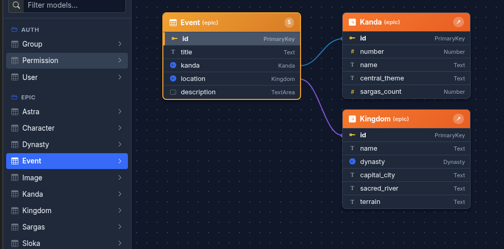

# Django Sastry (django-sastry)

[](https://github.com/globalkrishna/django-sastry/actions/workflows/ci.yml)
[](https://opensource.org/licenses/MIT)
[](https://www.python.org/)
[](https://www.djangoproject.com/)

A lightweight, zero-configuration dynamic CRUD administration interface and interactive visual **Entity Relations (ER) Diagram** engine for Django.

<p align="center">
  
</p>

---

## Highlights & Features

1. **Interactive Visual Entity Relations (ER) Diagram**:
   - **Right-Anchored Selected Model**: The active selected table is anchored to the extreme right, directly adjacent to the field inspector panel, with incoming reverse relations (`has_many` / child tables in cyan) and outgoing foreign key targets (in warm tones) plotted across vertical columns to the left.
   - **Reactive Schema Navigation**: Click any table card or foreign key to immediately make it the active model and move it to the right, refreshing all its upstream and downstream relations.
   - **Multi-Column Bin-Packing**: Automatically distributes child and referenced tables across vertical columns to the left to prevent tall single-column spillover for heavily connected models.
   - **Vector Connection Canvas**: Color-coded relational links with directional arrowheads for child table reverse relations and circular anchor nodes for foreign key targets.
   - **Field-Level Inspector**: Click any field in the active table to view its verbose name, Django internal type, nullability, blankness, uniqueness, database indexes, and reverse references.

2. **Zero-Config Dynamic CRUD**:
   - Instant spreadsheet-style data grid for all registered Django models without requiring boilerplate `admin.py` registrations.
   - Paginated browsing, multi-field filtering, search, and inline record creation/editing.
   - Safe foreign key resolution with query limits preventing unbounded database loads.

3. **Modular ERP Application Foundation**:
   - Extensible base template hierarchy (`saz3.html` -> `saz3Nav.html` -> `s_home.html`) powering enterprise suites (such as `erp.saas3.in`).
   - Easily inject custom modules into the navigation bar (Orders, Customer, Inventory, BOM, Sales, Billing).
   - Reusable `getData` / `mdlData` backend pipelines and subclassable frontend controllers (`class CustomerController extends db_crud`) with custom action triggers (like `#ShowExtraDetail` for Orders).

4. **Lightweight & Non-Intrusive**:
   - Introspects model structure using Django's native `Model._meta` APIs in memory with zero database queries during diagram generation.
   - Zero external frontend dependencies: built with modern vanilla ES6 JavaScript and HTML5 Canvas.

---

## Documentation & User Manual

For an in-depth walkthrough of the system, including visual diagrams, color specifications, and step-by-step guides for extending Sastry into a custom ERP application, see the official manual:

👉 **[Comprehensive User Manual & ERP Extensibility Guide (docs/USER_MANUAL.md)](docs/USER_MANUAL.md)**

### Manual Highlights:
- **[Interactive Visual ER Diagram Guide](docs/USER_MANUAL.md#3-interactive-visual-er-diagram)**: Details on the right-anchored model layout, right-to-left multi-column bin packing, color conventions (Gold, Cyan, Amber), and reactive table-clicking.
- **[Dynamic CRUD Data Grid Guide](docs/USER_MANUAL.md#4-dynamic-crud-data-grid)**: Filtering, sorting, pagination, inline edits, and foreign key optimization.
- **[ERP Extensibility Guide](docs/USER_MANUAL.md#5-erp-extensibility-guide-the-erpsaas3in-architecture)**: How to hook custom pages from the index navbar (`s_home.html`), author custom views reusing `getData`, build offcanvas filter drawers (`FilterType`), and subclass `db_crud` to display custom buttons like `[⤢ Orders]`.
- **[Python & JavaScript API Reference](docs/USER_MANUAL.md#7-api-reference)**: Complete function signatures and class definitions.

---

## Installation

Install via pip:

```bash
pip install django-sastry
```

Or install directly from GitHub:

```bash
pip install git+https://github.com/globalkrishna/django-sastry.git
```

---

## Quickstart

### 1. Add to `INSTALLED_APPS`

In your Django `settings.py`:

```python
INSTALLED_APPS = [
    # ...
    "sastry",
]
```

### 2. Configure Jinja2 Templates

In your Django `settings.py`:

```python
TEMPLATES = [
    {
        "BACKEND": "django.template.backends.jinja2.Jinja2",
        "APP_DIRS": True,
        "OPTIONS": {
            "environment": "config.jinja2.environment",
        },
    },
    {
        "BACKEND": "django.template.backends.django.DjangoTemplates",
        "APP_DIRS": True,
        # ...
    },
]
```

Define the standard environment helper in `config/jinja2.py`:

```python
from jinja2 import Environment
from django.templatetags.static import static
from django.urls import reverse

def environment(**options):
    env = Environment(**options)
    env.globals.update({"static": static, "url": reverse})
    return env
```

### 3. Include URLs

In your project's root `urls.py`:

```python
from django.urls import path, include

urlpatterns = [
    # ...
    path("sastry/", include("sastry.urls")),
]
```

### 4. Collect Static Assets

```bash
python manage.py collectstatic --noinput
```

### 5. Access the Interfaces

Start your development server:

```bash
python manage.py runserver
```

- **Visual ER Diagram**: Navigate to `http://127.0.0.1:8000/sastry/er/`
- **Dynamic CRUD Grid**: Navigate to `http://127.0.0.1:8000/sastry/`

---

## Security & Permissions

Access to `/sastry/` and `/sastry/er/` requires standard administrator authentication:
- `request.user.is_superuser` or `request.user.is_admin` must evaluate to `True`.
- Non-administrators receive an HTTP 403 Forbidden response.

---

## License

MIT License. Developed by Krishnamurthy (Global Multimedia).
Contributions and feature suggestions are welcome!

