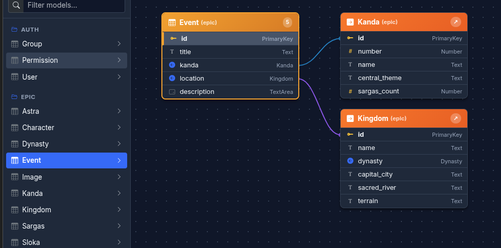

# Django Sastry (django-sastry)

[](https://github.com/globalkrishna/django-sastry/actions/workflows/ci.yml)
[](https://opensource.org/licenses/MIT)
[](https://www.python.org/)
[](https://www.djangoproject.com/)

A lightweight, zero-configuration dynamic CRUD administration interface and interactive visual **Entity Relations (ER) Diagram** engine for Django.

<p align="center">
  
</p>

---

## Highlights & Features

1. **Interactive Visual Entity Relations (ER) Diagram**:
   - **Right-Anchored Selected Model**: The active selected table is anchored to the extreme right, directly adjacent to the field inspector panel, with incoming reverse relations (`has_many` / child tables in cyan) and outgoing foreign key targets (in warm tones) plotted across vertical columns to the left.
   - **Reactive Schema Navigation**: Click any table card or foreign key to immediately make it the active model and move it to the right, refreshing all its upstream and downstream relations.
   - **Multi-Column Bin-Packing**: Automatically distributes child and referenced tables across vertical columns to the left to prevent tall single-column spillover for heavily connected models.
   - **Vector Connection Canvas**: Color-coded relational links with directional arrowheads for child table reverse relations and circular anchor nodes for foreign key targets.
   - **Field-Level Inspector**: Click any field in the active table to view its verbose name, Django internal type, nullability, blankness, uniqueness, database indexes, and reverse references.

2. **Zero-Config Dynamic CRUD**:
   - Instant spreadsheet-style data grid for all registered Django models without requiring boilerplate `admin.py` registrations.
   - Paginated browsing, multi-field filtering, search, and inline record creation/editing.
   - Safe foreign key resolution with query limits preventing unbounded database loads.

3. **Modular ERP Application Foundation**:
   - Extensible base template hierarchy (`saz3.html` -> `saz3Nav.html` -> `s_home.html`) powering enterprise suites (such as `erp.saas3.in`).
   - Easily inject custom modules into the navigation bar (Orders, Customer, Inventory, BOM, Sales, Billing).
   - Reusable `getData` / `mdlData` backend pipelines and subclassable frontend controllers (`class CustomerController extends db_crud`) with custom action triggers (like `#ShowExtraDetail` for Orders).

4. **Native Multi-Tenant SaaS Architecture & Row-Level Isolation**:
   - Zero-boilerplate multi-tenancy: automatic row-level query scoping (`store_id = request.store.id` or `tenant_id = request.tenant.id`).
   - Role-based model whitelisting preventing non-superusers from inspecting or altering sensitive system tables.
   - Automatic tenant foreign key stamping on record creation and safe tenant ownership validation on mutation.
   - 100% backward-compatible: transparently disabled when `SASTRY_MULTI_TENANT` is omitted.

5. **Lightweight & Non-Intrusive**:
   - Introspects model structure using Django's native `Model._meta` APIs in memory with zero database queries during diagram generation.
   - Zero external frontend dependencies: built with modern vanilla ES6 JavaScript and pure SVG / HTML5 Canvas.

---

## The Core Philosophy: The 90/10 Architecture of Database Applications

> *"Most database applications center around selecting some filtered rows, and selecting one of them to view details in a custom way."*

In traditional enterprise software development, building any new module (such as Customer Management, Job Cards, or Fabric Inventory) requires writing substantial boilerplate: API endpoints, pagination, multi-column search, filter drawers, sorting SQL, table HTML, form builders, and relational bindings. This mundane plumbing consumes **80% to 90%** of development time.

**`django-sastry` solves this by inverting the pyramid:**
- **The 90% (Out-of-the-Box)**: Sastry automatically provides the high-performance relational data grid, instant dynamic search, multi-field filtering, pagination, inline modal editing, and visual ER schema diagram.
- **The 10% (Your Custom View)**: You only write the domain-specific detail view (an itemized order dossier, a bespoke canvas designer, or a retail invoice).

### The Pattern in Action: A Complete Application in ~40 Lines

#### 1. Backend: Thin View with `getData` (`views.py`)
```python
@login_required
def CustomersList(request, ctyp=0):
    dat = json.loads(request.GET.get("dat", "{}"))
    types = CustomerType.objects.all().order_by("name").values_list("id", "name")
    if not ctyp and types:
        ctyp = types[0][0]
    if "filter" not in dat:
        dat["filter"] = {"customer_type_id": ctyp}
    dat["show"] = ["id", "customer_id", "name", "city", "state_id"]
    
    # Sastry handles the complete query, pagination, sorting, and serialization:
    data = getData("customer", "Customer", dat)
    data["ctype"] = types
    return render(request, "CustomerPage.html", data)
```

#### 2. Frontend: Subclassing `db_crud` (`customer.ts`)
```typescript
import { db_crud } from '/static/sastry/js/s_crud.js';

class CustomerListController extends db_crud<Customer> {
    constructor() {
        super();
        this.setData();
        // Hook custom filter buttons (e.g. Retail, Wholesale, Distributor)
        document.querySelectorAll('#FilterType a').forEach(el => {
            el.onclick = (e) => this.filterByType(e);
        });
        // Enable Sastry's built-in toolbar action button for drill-down
        const extraBtn = document.getElementById("ShowExtraDetail");
        extraBtn.textContent = "Orders";
        extraBtn.classList.remove('d-none');
    }

    ShowTab(tab: string) {
        super.ShowTab(tab);
        if (tab !== 'ExtraDetail') return;

        // Retrieve selected row from Sastry's active table
        const indexRow = document.querySelector('#index tbody tr.table-active') as HTMLTableRowElement;
        const customer = this.collection[indexRow.rowIndex - 1];

        // Fetch and display the custom detail view for this customer:
        fetch(`/customer/cust_order/${customer.id}/`)
            .then(res => res.text())
            .then(html => {
                document.getElementById('ExtraDetail')!.innerHTML = html;
                document.querySelector("#ExtraDetail #Bak2index")!.onclick = () => this.ShowTab('index');
            });
    }
}
```

By simply writing the custom detail view and connecting it via Sastry's extension points, you achieve a **production-ready, enterprise-grade application** in a few hours.

---

## Documentation & User Manual

For an in-depth walkthrough of the system, including visual diagrams, color specifications, and step-by-step guides for extending Sastry into a custom ERP application, see the official manual:

👉 **[Comprehensive User Manual & ERP Extensibility Guide (docs/USER_MANUAL.md)](docs/USER_MANUAL.md)**

### Manual Highlights:
- **[Interactive Visual ER Diagram Guide](docs/USER_MANUAL.md#3-interactive-visual-er-diagram)**: Details on the right-anchored model layout, right-to-left multi-column bin packing, color conventions (Gold, Cyan, Amber), and reactive table-clicking.
- **[Dynamic CRUD Data Grid Guide](docs/USER_MANUAL.md#4-dynamic-crud-data-grid)**: Filtering, sorting, pagination, inline edits, and foreign key optimization.
- **[ERP Extensibility Guide](docs/USER_MANUAL.md#5-erp-extensibility-guide-the-erpsaas3in-architecture)**: How to hook custom pages from the index navbar (`s_home.html`), author custom views reusing `getData`, build offcanvas filter drawers (`FilterType`), and subclass `db_crud` to display custom buttons like `[⤢ Orders]`.
- **[Python & JavaScript API Reference](docs/USER_MANUAL.md#7-api-reference)**: Complete function signatures and class definitions.

---

## Installation

Install via pip:

```bash
pip install django-sastry
```

Or install directly from GitHub:

```bash
pip install git+https://github.com/globalkrishna/django-sastry.git
```

---

## Quickstart

### 1. Add to `INSTALLED_APPS`

In your Django `settings.py`:

```python
INSTALLED_APPS = [
    # ...
    "sastry",
]
```

### 2. Configure Jinja2 Templates

In your Django `settings.py`:

```python
TEMPLATES = [
    {
        "BACKEND": "django.template.backends.jinja2.Jinja2",
        "APP_DIRS": True,
        "OPTIONS": {
            "environment": "config.jinja2.environment",
        },
    },
    {
        "BACKEND": "django.template.backends.django.DjangoTemplates",
        "APP_DIRS": True,
        # ...
    },
]
```

Define the standard environment helper in `config/jinja2.py`:

```python
from jinja2 import Environment
from django.templatetags.static import static
from django.urls import reverse

def environment(**options):
    env = Environment(**options)
    env.globals.update({"static": static, "url": reverse})
    return env
```

### 3. Include URLs

In your project's root `urls.py`:

```python
from django.urls import path, include

urlpatterns = [
    # ...
    path("sastry/", include("sastry.urls")),
]
```

### 4. (Optional) Enable Native Multi-Tenancy for SaaS

To enable automatic tenant/store row-level isolation and role-based model whitelisting, add `SASTRY_MULTI_TENANT` to your `settings.py`:

```python
SASTRY_MULTI_TENANT = {
    "ENABLED": True,
    # Attributes on request to resolve active tenant (e.g. request.store or request.tenant)
    "TENANT_REQUEST_ATTRS": ["store", "tenant", "organization", "company"],
    # Model foreign key field names indicating tenant ownership
    "TENANT_MODEL_FIELDS": ["store", "tenant", "organization", "company"],
    # Permission mode: 'staff_with_tenant', 'superuser_only', or custom callable
    "PERMISSION_MODE": "staff_with_tenant",
    # Model Whitelist for tenant users (Superusers retain unrestricted access)
    "ALLOWED_MODELS": {
        "inventory": ["PurchaseOrder", "Vendor", "Purchase", "DebitNote", "StoreInventory"],
        "billing": ["Customer", "SalesPerson", "Invoice"],
        "catalog": ["Product", "ProductVariant"],
    },
    # Models always hidden from non-superusers
    "EXCLUDED_MODELS": [
        "admin.*", "sessions.*", "contenttypes.*", "auth.Permission",
        "tenants.Tenant", "tenants.Store",
    ],
    # Automatically stamp tenant foreign key when new records are created
    "AUTO_STAMP_ON_CREATE": True,
}
```

### 5. Collect Static Assets

```bash
python manage.py collectstatic --noinput
```

### 6. Access the Interfaces

Start your development server:

```bash
python manage.py runserver
```

- **Visual ER Diagram**: Navigate to `http://127.0.0.1:8000/sastry/er/`
- **Dynamic CRUD Grid**: Navigate to `http://127.0.0.1:8000/sastry/`

---

## Declarative Model Options, Read-Only Fields & Custom Actions

Sastry 2.1 introduces a zero-boilerplate declarative API to configure model behavior, lock read-only fields, register custom toolbar actions, and configure async search without subclassing view controllers.

### 1. In `settings.py` (Centralized Configuration)
```python
SASTRY_CONFIG = {
    "auth.User": {
        "readonly_fields": ["date_joined", "last_login"],
        "autocomplete_fields": ["groups"],
    },
    "acc.BillPayment": {
        "readonly_fields": ["created_at", "voucher_no"],
        "autocomplete_fields": ["voucher_item"],
    },
}
```

### 2. In `models.py` or `admin.py` (Code-Level Registration)
```python
from sastry import register_model_options, sastry_action, sastry_options

# Option A: Functional registration
register_model_options(
    "customer.Customer",
    readonly_fields=["vendor_code", "opening_balance"],
    autocomplete_fields=["parent_account"],
    search_fields=["name", "city", "phone"],
)

# Option B: Model class decorator
@sastry_options(
    readonly_fields=["created_at"],
    autocomplete_fields=["supplier"],
)
class Order(models.Model):
    ...

# Custom bulk action for the table toolbar
@sastry_action(model="customer.Customer", description="Sync to CRM")
def sync_to_crm(request, queryset):
    count = queryset.count()
    # Execute custom business logic across checked rows
    return {"success": True, "message": f"Successfully queued {count} records for CRM sync."}
```

### 3. In Custom Master-Detail Views (`mdlData`)
Pass read-only fields directly in the `dat` dictionary:
```python
dat = {
    "show": ["id", "name", "city", "state_id"],
    "rd_only": ["state_id"],  # 🔒 Disables cell editing, adds header lock icon, and protects on save
}
data = mdlData("customer", "Customer", dat)
```

---

## Dynamic Autocomplete & Large Table Scalability

For high-volume transaction databases (hundreds of thousands of records in `Stock`, `VoucherItem`, or `Ledger`):
- **Automatic DOM Protection**: Sastry detects when a related table exceeds the safety threshold (`> 10,000` rows) and automatically limits the initial HTML choice payload to active row IDs + top recent entries, eliminating browser freezes.
- **Async Autocomplete API**: Queries are debounced and executed on the fly via `/sastry/autocomplete/<app>/<model>/?q=search_term`. Matching results are injected into the datalist dynamically as the user types.

---

## Native Multi-Tenant SaaS Architecture

In multi-tenant SaaS environments (retail POS, franchise ERPs, multi-entity accounting), exposing monolithic admin interfaces to store staff is a critical security and privacy hazard.

`django-sastry` 2.0 incorporates a first-class **Multi-Tenant Engine (`sastry.tenant.TenantManager`)**:

- **Automatic Row-Level Scoping**: Queries automatically inject tenant filters (`store_id = request.store.id`). Store 160 can never view or manipulate rows from Store 161.
- **Model Gatekeeping**: Tenant staff only see allowed business models (`ALLOWED_MODELS`). Accessing system tables (`Tenant`, `User`, `Sessions`) returns an HTTP 403 Forbidden.
- **Safe Auto-Stamping**: Newly created records are automatically stamped with `instance.store = request.store`, eliminating cashier dropdown errors.
- **Cross-Tenant Mutation Protection**: Updates and deletes verify tenant ownership before committing, preventing cross-tenant ID spoofing.
- **Foreign Key Choice Scoping**: Form dropdowns in modals only list relational choices (Vendors, Customers, Warehouses) belonging to the active tenant.
- **100% Backward Compatible**: When `SASTRY_MULTI_TENANT` is omitted, Sastry operates in standard single-tenant mode with zero overhead.

---

## Security & Permissions

Access to `/sastry/` and `/sastry/er/` is evaluated dynamically based on your configuration:
- **Single-Tenant Mode (Default)**: Access is strictly restricted to `request.user.is_superuser` or `request.user.is_admin`.
- **Multi-Tenant Mode**: Authenticated tenant staff operating within an active tenant context (`request.store` / `request.tenant`) are granted scoped access to whitelisted models, while superusers retain global visibility across all stores.

---

## License

MIT License. Developed by Krishnamurthy (Global Multimedia).
Contributions and feature suggestions are welcome!

