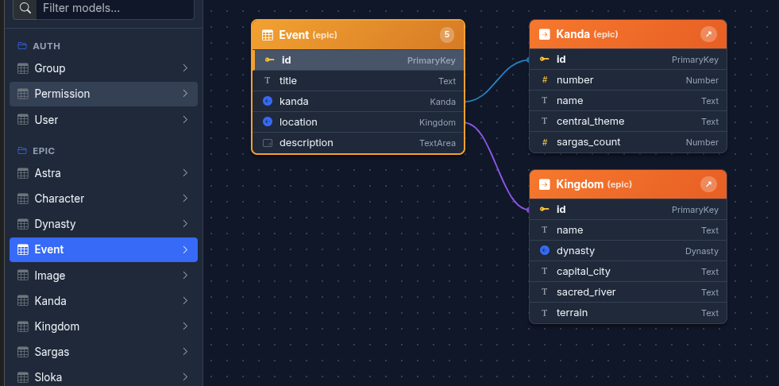

# Django Sastry: Comprehensive User Manual & ERP Extensibility Guide

`django-sastry` is a high-performance, zero-configuration dynamic CRUD administration interface, relational schema visualization engine, and modular ERP application foundation for Django.

---

## Table of Contents

1. [Architecture & Philosophy](#1-architecture--philosophy)
2. [Quickstart & Configuration](#2-quickstart--configuration)
3. [Interactive Visual ER Diagram](#3-interactive-visual-er-diagram)
   - [Right-Anchored Selected Model](#right-anchored-selected-model)
   - [Right-to-Left Multi-Column Bin-Packing](#right-to-left-multi-column-bin-packing)
   - [Visual Color Conventions](#visual-color-conventions)
   - [Reactive Navigation & Field Inspector](#reactive-navigation--field-inspector)
4. [Dynamic CRUD Data Grid](#4-dynamic-crud-data-grid)
   - [Zero-Boilerplate Model Browsing](#zero-boilerplate-model-browsing)
   - [Filtering, Sorting, and Pagination](#filtering-sorting-and-pagination)
   - [Inline Editing & Modal Forms](#inline-editing--modal-forms)
   - [Safe Foreign Key Query Limiting](#safe-foreign-key-query-limiting)
5. [ERP Extensibility Guide (The `erp.saas3.in` Architecture)](#5-erp-extensibility-guide-the-erpsaas3in-architecture)
   - [Template Inheritance Hierarchy](#template-inheritance-hierarchy)
   - [Enterprise Navigation Bar (`s_home.html`)](#enterprise-navigation-bar-s_homehtml)
   - [Authoring Custom ERP Views](#authoring-custom-erp-views)
   - [Custom ERP Page Templates & Offcanvas Filters](#custom-erp-page-templates--offcanvas-filters)
   - [Extending the Frontend Controller (`db_crud`)](#extending-the-frontend-controller-db_crud)
   - [Adding Custom Action Buttons (e.g., "Orders" Drawer)](#adding-custom-action-buttons-eg-orders-drawer)
6. [Security & Access Control](#6-security--access-control)
7. [API Reference](#7-api-reference)

---

## 1. Architecture & Philosophy

`django-sastry` serves two complementary roles in modern Django software engineering:

1. **Zero-Configuration Dynamic Admin & Schema Inspector**:
   Unlike Django's default `django.contrib.admin`—which requires manually registering `admin.ModelAdmin` classes across every app—Sastry dynamically introspects `apps.get_models()` and model `_meta` APIs in memory with zero boilerplate and zero database overhead.

2. **Extensible ERP Application Foundation**:
   In complex enterprise systems (such as `erp.saas3.in`), Sastry acts as the unified base application shell:
   - Provides a responsive Bootstrap 5 theme with native Dark/Light mode toggle.
   - Provides an extensible navigation structure (`saz3.html`, `saz3Nav.html`, `s_home.html`).
   - Exposes reusable data retrieval pipelines (`getData`, `mdlData`) with built-in pagination, sorting, and JSON formatting.
   - Provides an extensible JavaScript/TypeScript CRUD controller (`db_crud`) that can be subclassed for domain-specific business logic (such as customer order tracking, inventory allocation, and billing workflows).

---

## 2. Quickstart & Configuration

### Installation

```bash
pip install django-sastry
```

Or install directly from your Git repository:

```bash
pip install git+https://github.com/globalkrishna/django-sastry.git
```

### Django Settings (`settings.py`)

Add `"sastry"` to your `INSTALLED_APPS`:

```python
INSTALLED_APPS = [
    "django.contrib.admin",
    "django.contrib.auth",
    "django.contrib.contenttypes",
    "django.contrib.sessions",
    "django.contrib.messages",
    "django.contrib.staticfiles",
    # ...
    "sastry",
]
```

Configure your Jinja2/Django template engine so Sastry's templates in `sastry/jinja2` are resolvable:

```python
TEMPLATES = [
    {
        "BACKEND": "django.template.backends.jinja2.Jinja2",
        "DIRS": [BASE_DIR / "jinja2"],
        "APP_DIRS": True,
        "OPTIONS": {
            "environment": "config.jinja2.environment",
        },
    },
    {
        "BACKEND": "django.template.backends.django.DjangoTemplates",
        "DIRS": [BASE_DIR / "templates"],
        "APP_DIRS": True,
        # ...
    },
]
```

### URL Routing (`urls.py`)

Include Sastry's URLs in your root `urls.py`:

```python
from django.urls import path, include

urlpatterns = [
    path("admin/", admin.site.urls),
    path("sastry/", include("sastry.urls")),
    # Your ERP app routes...
]
```

### Available Endpoints

- **`/sastry/`**: Dynamic CRUD Data Grid index.
- **`/sastry/er/`**: Interactive Visual ER Diagram.
- **`/sastry/er/api/<app_label>/<model_name>/`**: Relational JSON metadata API for any model.
- **`/sastry/<app>/<mdl>/<dat>/`**: Model CRUD data and form endpoints.

---

## 3. Interactive Visual ER Diagram

Access the diagram at `http://127.0.0.1:8000/sastry/er/` (or via the **ER Diagram** button in the top navigation).

<p align="center">
  
</p>

```
+---------------------------------------------------------------------------------------------------+
|  [Search Model...]                       (Columns: Left-to-Right)           | Selected Model Card |
|                                                                             | [Gold Header]       |
|  +--------------------+   +--------------------+   +--------------------+   +-------------------+ |
|  | Child Table (Cyan) |   | Parent Table (Amber)|  | Child Table (Cyan) |==>| id (PK)           | |
|  | [has_many relation]|   | [foreign key target]|  | [has_many relation]|   | name              | |
|  +--------------------+   +--------------------+   +--------------------+   | customer_type_id  | |
|                                                                             +-------------------+ |
|                                                                             | Inspector Panel   | |
|                                                                             | - Field attributes| |
|                                                                             | - Reverse refs    | |
+---------------------------------------------------------------------------------------------------+
```

### Right-Anchored Selected Model

In large enterprise databases with highly-connected models (e.g., `Customer`, `Order`, `Finish`, `Item`), plotting relationships from left to right causes the active model to be separated from its inspector sidebar by dozens of child tables.

`django-sastry` employs a **Right-Anchored Layout**:
- The **Selected Table** is positioned on the **extreme right** (`canvasWidth - colWidth - 40`), immediately adjacent to the right-hand **Field Inspector** panel.
- All related tables (incoming child tables and outgoing foreign tables) are placed to its left.

### Right-to-Left Multi-Column Bin-Packing

When an ERP table connects to 20+ tables, a single column causes severe vertical spillover. Sastry automatically distributes related tables across multiple vertical columns:
1. Calculates available horizontal columns from the left edge up to the selected table.
2. Uses **minimum-height bin packing** to assign each related table card to the shortest column.
3. Automatically tie-breaks placement toward columns closest to the selected table, minimizing connection line crossing.

### Visual Color Conventions

- **Gold / Yellow Header (`#eab308`)**: The **Selected Active Table**.
- **Cyan Header (`#06b6d4`)**: **Child Tables** (`has_many` reverse relations where another table holds a foreign key pointing back to this model).
- **Warm Amber Header (`#ea580c`)**: **Foreign Tables** (upstream reference tables that the active model points to).
- **Blue Field Badge (`PK`)**: Primary Key.
- **Cyan Badge (`has_many`)**: Reverse relationship link.
- **Amber Arrow (`FK`)**: Outgoing Foreign Key relation.

### Reactive Navigation & Field Inspector

1. **One-Click Model Switch**: Click anywhere on any related table card on the canvas or in the left sidebar to immediately make it the selected model. It instantly transitions to the extreme right and plots all its upstream and downstream relations.
2. **Foreign Key Quick-Jump**: Click the FK icon or pill next to any foreign key row to jump directly to the target referenced model.
3. **Field Inspector**: Click any row in the active model to view its metadata in the right inspector:
   - Verbose name and DB column name
   - Django internal field type (`CharField`, `DateTimeField`, `ForeignKey`, etc.)
   - Nullability (`null=True/False`), Blankness (`blank=True/False`)
   - Unique constraints and Database index flags
   - Enabled reverse relations list

---

## 4. Dynamic CRUD Data Grid

Access the grid at `http://127.0.0.1:8000/sastry/` (or via the **Data Grid** button).

### Zero-Boilerplate Model Browsing

- The top navigation bar includes an **App Selector** and a searchable **Model Datalist**.
- Selecting an app/model dynamically requests schema details and renders an interactive spreadsheet-style table without reloading the entire page.

### Filtering, Sorting, and Pagination

- **Multi-Field Filtering**: Click the Filter icon (`bi-funnel`) to open column filters for exact matching, case-insensitive substring searching, date ranges, and boolean toggles.
- **Column Sorting**: Click any table header to toggle between ascending (`ASC`) and descending (`DESC`) order.
- **Pagination**: Jump to specific pages, navigate with previous/next arrows, or change rows per page (e.g. 10, 20, 40, 100 rows).

### Inline Editing & Modal Forms

- **Inline Edit**: Click the Edit icon (`bi-pencil`) to enable inline cell editing for quick updates directly within the grid.
- **Modal Form**: Click the Add icon (`bi-plus-circle`) to open a clean Bootstrap 5 modal containing auto-generated Django form fields with field-type validation.
- **File and Image Uploads**: Seamlessly handles image previews and asynchronous file uploads.

### Safe Foreign Key Query Limiting

In large databases with hundreds of thousands of records, generating a `<select>` dropdown for a foreign key can exhaust server memory.

Sastry automatically limits foreign key querysets:
```python
def optimize_form_querysets(form, rows=None, max_limit=150):
    # Restricts choices to IDs present in current page rows or caps at max_limit
    ...
```
This guarantees sub-second page rendering even when referencing tables with millions of rows.

---

## 5. ERP Extensibility Guide (The `erp.saas3.in` Architecture)

`django-sastry` is designed specifically to serve as the application skeleton for custom ERP suites (such as `erp.saas3.in` with its Customer, Orders, Inventory, BOM, Sales, and Accounting modules).

```
                      +-------------------+
                      |     saz3.html     |  (Base Shell: HTML5, Bootstrap 5, Theme Toggle, User Menu)
                      +---------+---------+
                                |
                      +---------v---------+
                      |    saz3Nav.html   |  (Navbar Shell: Top Links, App/Model Selectors)
                      +---------+---------+
                                |
             +------------------+------------------+
             |                                     |
  +----------v----------+               +----------v----------+
  |    s_admin.html     |               |     s_home.html     |
  | (Sastry Admin View) |               | (Enterprise Nav)    |
  +----------+----------+               +----------+----------+
             |                                     |
  +----------v----------+               +----------v----------+
  | Custom ERP Modules  |               | Custom ERP Views    |
  | (Customer, Orders)  |               | (CustomerPage.html) |
  +---------------------+               +---------------------+
```

### Template Inheritance Hierarchy

- **`saz3.html`**: Root layout defining the responsive viewport, Bootstrap 5 CSS/JS, Dark/Light theme switching script, top navbar skeleton, and content blocks:
  - ``
  - ``: Navbar items.
  - ``: Modals and dialogs.
  - ``: Main viewport body.
  - ``: Script bundles and custom modules.
- **`saz3Nav.html`**: Extends `saz3.html` and includes `s_HomeLink.html` by default.
- **`s_admin.html`**: Default administrative entry point for Sastry's dynamic CRUD.

---

### Enterprise Navigation Bar (`s_home.html`)

In your custom ERP application, you can create a custom `s_home.html` to replace the simple app selector with full enterprise navigation dropdowns:

```html
<!-- jinja2/s_home.html -->
<ul class="navbar-nav me-auto mb-2 mb-lg-0">
  

  <!-- Customer Module -->
  <li class="nav-item dropdown">
    <a class="nav-link dropdown-toggle active"
       data-bs-toggle="dropdown" href="#" role="button">Customer</a>
    <div class="dropdown-menu">
      <a class="dropdown-item" href="/customer/list/">Customer List</a>
      <a class="dropdown-item" href="/customer/index/">Orders</a>
      <a class="dropdown-item" href="/customer/invoices/">Invoices</a>
    </div>
  </li>

  <!-- Inventory Module -->
  <li class="nav-item dropdown">
    <a class="nav-link dropdown-toggle active"
       data-bs-toggle="dropdown" href="#" role="button">Inventory</a>
    <div class="dropdown-menu">
      <a class="dropdown-item" href="/inventory/index/">Items</a>
      <a class="dropdown-item" href="/inventory/stock/">Stock Report</a>
      <a class="dropdown-item" href="/inventory/bom/">BOM Management</a>
    </div>
  </li>

  <!-- Sales Module -->
  <li class="nav-item dropdown">
    <a class="nav-link dropdown-toggle active"
       data-bs-toggle="dropdown" href="#" role="button">Sales</a>
    <div class="dropdown-menu">
      <a class="dropdown-item" href="/sales/order/">New Order</a>
      <a class="dropdown-item" href="/sales/pos/">POS Billing</a>
    </div>
  </li>
</ul>
```

To activate this across your admin views, configure `madmin = "s_home.html"` in your base template:

```html
<!-- jinja2/admin.html -->



```

---

### Authoring Custom ERP Views

Use Sastry's `getData` (or `mdlData`) directly inside your custom Django views to get automatic pagination, filtering, and model field introspection:

```python
# customer/views.py
import json
from django.shortcuts import render, redirect
from django.contrib.auth.decorators import login_required
from sastry.dbadmin import getData  # or your project's mdlData wrapper
from .models import Customer, CustomerType

@login_required
def CustomersList(request, ctyp=0):
    if not request.user.is_staff:
        return redirect("/")

    dat = json.loads(request.GET.get("dat", "{}"))
    types = CustomerType.objects.all().order_by("name").values_list("id", "name")
    
    if not ctyp and types:
        ctyp = types[0][0]

    if "filter" not in dat:
        dat["filter"] = {"customer_type_id": ctyp}

    # Restrict visible columns to relevant ERP fields
    dat["show"] = ["id", "customer_code", "name", "city", "state_id"]
    dat["restrict"] = [0]

    # Retrieve data using Sastry's data engine
    data = getData("customer", "Customer", dat)
    data["ctype"] = types
    data["selected_type"] = ctyp

    return render(request, "CustomerPage.html", data)
```

---

### Custom ERP Page Templates & Offcanvas Filters

Combine Sastry's grid components (`s_filter_opt.html`, `s_default.html`) with custom Bootstrap Offcanvas filters:

```html
<!-- customer/jinja2/CustomerPage.html -->



<!-- Standard Sastry Filter Toolbar -->


<!-- Left Offcanvas for Customer Type Selection -->
<div class="offcanvas offcanvas-start show" id="FilterType" data-bs-scroll="true" data-bs-backdrop="false"
     style="width: 16ch;" tabindex="-1">
  <div class="offcanvas-header py-2">
    <h6 class="offcanvas-title fw-bold">Customer Type</h6>
  </div>
  <div class="offcanvas-body p-1">
    <div class="list-group list-group-flush small">
      
      <a class="list-group-item list-group-item-action py-1 px-2 active"
         href="{{ ct[0] }}">{{ ct[1] }}</a>
      
    </div>
  </div>
</div>

<!-- Sastry Dynamic Table Container -->
<div id="content_d">
  
</div>



<!-- Include Sastry Base CRUD Controller -->
<script type="module" src="/static/sastry/js/s_crud.js"></script>
<!-- Include Module-Specific Controller -->
<script type="module" src="/static/js/customer.js"></script>

```

---

### Extending the Frontend Controller (`db_crud`)

Sastry's frontend is architected as an extensible ES6/TypeScript class (`db_crud`). In your ERP module, simply subclass `db_crud` to add custom event handlers and reactive actions:

```javascript
// static/js/customer.js
import { db_crud } from '/static/sastry/js/s_crud.js';

class CustomerListController extends db_crud {
    constructor() {
        super();
        this.setData();
        this.initTypeFilter();
        this.initOrdersButton();
    }

    initTypeFilter() {
        document.querySelectorAll('#FilterType a').forEach(item => {
            item.onclick = (e) => this.filterByType(e);
        });
    }

    filterByType(e) {
        e.preventDefault();
        e.stopPropagation();

        const active = document.querySelector('#FilterType a.active');
        if (active) active.classList.remove('active');
        e.target.classList.add('active');

        const typeId = e.target.getAttribute('href');
        this.filter = { 'customer_type_id': typeId };
        this.setColl(1); // Reload grid at page 1
    }

    initOrdersButton() {
        // Activate Sastry's built-in #ShowExtraDetail toolbar button
        const extraBtn = document.getElementById("ShowExtraDetail");
        if (extraBtn) {
            extraBtn.innerHTML = '<i class="bi bi-arrows-angle-expand me-1"></i> Orders';
            extraBtn.classList.remove('d-none');
            extraBtn.onclick = () => this.openSelectedCustomerOrders();
        }
    }

    openSelectedCustomerOrders() {
        const selectedCheckbox = document.querySelector('#content_d input[type="checkbox"]:checked');
        if (!selectedCheckbox) {
            alert('Please select a customer first to view orders.');
            return;
        }
        const customerId = selectedCheckbox.value;
        window.location.href = `/customer/index/${customerId}/`;
    }
}

document.addEventListener('DOMContentLoaded', () => {
    window.customerController = new CustomerListController();
});
```

---

### Adding Custom Action Buttons (e.g., "Orders" Drawer)

Sastry includes a built-in toolbar slot for custom contextual actions:

```html
<!-- Inside s_default.html -->
<button type="button" class="btn btn-sm btn-dark d-none" id="ShowExtraDetail">
  List of Items
</button>
```

By default, `#ShowExtraDetail` is hidden (`d-none`). To display your custom action (e.g. **Orders**, **BOM Breakdown**, or **Credit History**):
1. In your custom controller constructor, call `extraBtn.textContent = "Orders"` (or use custom icons).
2. Remove `d-none`.
3. Attach your custom workflow callback or use `this.ShowTab('ExtraDetail')` to open a connected drawer.

---

## 6. Security & Access Control

Access to Sastry endpoints is restricted at the view level using `@login_required` and administrator permission checks:

```python
if not (request.user.is_superuser or getattr(request.user, "is_admin", False)):
    return HttpResponseForbidden("Access restricted to administrators.")
```

For customer-facing or staff-facing ERP views, you can apply standard Django permissions (e.g., `@login_required`, `request.user.is_staff`, or custom permission mixins) while continuing to use Sastry's data grid and template components.

---

## 7. API Reference

### Python Backend Functions (`sastry.dbadmin`)

| Function | Signature | Description |
|---|---|---|
| `index(request)` | `(HttpRequest) -> HttpResponse` | Dynamic CRUD index view rendering `s_admin.html` with all registered app models. |
| `er_view(request)` | `(HttpRequest) -> HttpResponse` | Visual ER Diagram interface rendering `erview/default.html`. |
| `er_schema_api(request, app_label, model_name)` | `(HttpRequest, str, str) -> JsonResponse` | Returns schema metadata, field types, PK/FK flags, foreign models, and `has_many` child models. |
| `getData(app, mdl, dat)` | `(str, str, dict) -> dict` | Introspects model, executes paginated/filtered queries, and formats columns and records for the grid. |
| `optimize_form_querysets(form, rows, max_limit)` | `(Form, list, int) -> Form` | Prevents runaway database queries on foreign key dropdown fields. |

### Frontend Classes & Hooks (`s_crud.js` & `er_diagram.js`)

| Component | Identifier | Description |
|---|---|---|
| `db_crud` | `class` in `s_crud.js` | Base CRUD client handling pagination, inline edits, modal submits, sorting, and filter queries. |
| `#ShowExtraDetail` | `HTMLButtonElement` | Built-in extensible action button in the grid toolbar (customizable for Orders, Details, etc.). |
| `SastryERDiagram` | `class` in `er_diagram.js` | Right-anchored ER engine handling right-to-left bin-packing, canvas bezier curves, and card interactions. |
| `loadModel(app, model)` | Method on `SastryERDiagram` | Asynchronously fetches model schema via API, anchors model on the right, and redraws relational canvas. |

---

## Contributing & License

`django-sastry` is licensed under the [MIT License](LICENSE).  
Maintained by Krishnamurthy & the Global Multimedia team. Pull requests and feedback are welcome!

