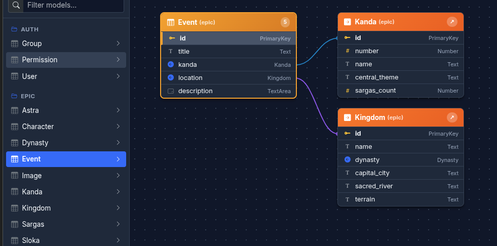

# Django Sastry: Comprehensive User Manual & ERP Extensibility Guide

`django-sastry` is a high-performance, zero-configuration dynamic CRUD administration interface, relational schema visualization engine, and modular ERP application foundation for Django.

---

## Table of Contents

1. [Architecture & Philosophy](#1-architecture--philosophy)
2. [Quickstart & Configuration](#2-quickstart--configuration)
3. [Interactive Visual ER Diagram](#3-interactive-visual-er-diagram)
   - [Right-Anchored Selected Model](#right-anchored-selected-model)
   - [Right-to-Left Multi-Column Bin-Packing](#right-to-left-multi-column-bin-packing)
   - [Visual Color Conventions](#visual-color-conventions)
   - [Reactive Navigation & Field Inspector](#reactive-navigation--field-inspector)
4. [Dynamic CRUD Data Grid](#4-dynamic-crud-data-grid)
   - [Zero-Boilerplate Model Browsing](#zero-boilerplate-model-browsing)
   - [Filtering, Sorting, and Pagination](#filtering-sorting-and-pagination)
   - [Inline Editing & Modal Forms](#inline-editing--modal-forms)
   - [Safe Foreign Key Query Limiting](#safe-foreign-key-query-limiting)
5. [ERP Extensibility Guide (The `erp.saas3.in` Architecture)](#5-erp-extensibility-guide-the-erpsaas3in-architecture)
   - [Template Inheritance Hierarchy](#template-inheritance-hierarchy)
   - [Enterprise Navigation Bar (`s_home.html`)](#enterprise-navigation-bar-s_homehtml)
   - [Authoring Custom ERP Views](#authoring-custom-erp-views)
   - [Custom ERP Page Templates & Offcanvas Filters](#custom-erp-page-templates--offcanvas-filters)
   - [Extending the Frontend Controller (`db_crud`)](#extending-the-frontend-controller-db_crud)
   - [Adding Custom Action Buttons (e.g., "Orders" Drawer)](#adding-custom-action-buttons-eg-orders-drawer)
6. [Multi-Tenant SaaS Architecture & Row-Level Isolation](#6-multi-tenant-saas-architecture--row-level-isolation)
   - [The Problem & Sastry Solution](#the-problem--sastry-solution)
   - [Enabling Native Multi-Tenancy (`settings.py`)](#enabling-native-multi-tenancy-settingspy)
   - [How the Engine Works Under the Hood](#how-the-engine-works-under-the-hood)
7. [Security & Access Control](#7-security--access-control)
8. [API Reference](#8-api-reference)
   - [Python Backend Functions (`sastry.dbadmin`)](#python-backend-functions-sastrydbadmin)
   - [Multi-Tenant Engine API (`sastry.tenant.TenantManager`)](#multi-tenant-engine-api-sastrytenanttenantmanager)
   - [Frontend Classes & Hooks (`s_crud.js` & `er_diagram.js`)](#frontend-classes--hooks-s_crudjs--er_diagramjs)

---

## 1. Architecture & Philosophy

### The 90/10 Architecture of Database Applications

> *"Most database applications center around selecting some filtered rows, and selecting one of them to view details in a custom way."*

In software engineering, this is known as the **Master-Detail** (or *Search-Filter-Browse-Inspect*) pattern. Across enterprise ERPs, CRMs, inventory managers, and billing systems, over 80–90% of user interactions follow this universal two-phase flow:

1. **Phase 1: Filtered Set Reduction**: Search, filter by criteria (e.g. status, customer type, date), sort, and browse paginated tabular records.
2. **Phase 2: Custom Entity Presentation**: Select a single row to inspect its rich, domain-specific details (an order invoice, a production card, a custom canvas designer, or a dispatch timeline).

In traditional development, engineering teams spend **80% to 90% of their time writing repetitive plumbing** for Phase 1 on every new business module: crafting SQL querysets, serializers, pagination widgets, multi-column search, filter drawers, form builders, and table templates.

**`django-sastry` inverts this equation:**
- **The 90% (Handled Out-of-the-Box)**: Sastry completely automates Phase 1. It provides dynamic relational data grids, instant search, multi-field filtering, pagination, inline modal editing, and visual ER schema exploration with zero configuration.
- **The 10% (Your Custom View)**: You only write the domain-specific detail presentation for Phase 2. By plugging your custom view into Sastry's extension hooks (`getData` / `s_crud.js`), you produce a complete, robust, enterprise-grade application in hours instead of weeks.

---

### Core Roles in Modern Django Engineering

`django-sastry` serves two complementary roles in modern Django software engineering:

1. **Zero-Configuration Dynamic Admin & Schema Inspector**:
   Sastry dynamically introspects `apps.get_models()` and model `_meta` APIs in memory with zero boilerplate and zero database overhead during schema generation, providing an instant spreadsheet-style data grid and visual ER diagram across all installed models.

2. **Extensible ERP Application Foundation**:
   In complex enterprise systems (such as `erp.saas3.in`), Sastry acts as the unified base application shell:
   - Provides a responsive Bootstrap 5 theme with native Dark/Light mode toggle.
   - Provides an extensible navigation structure (`saz3.html`, `saz3Nav.html`, `s_home.html`).
   - Exposes reusable data retrieval pipelines (`getData`, `mdlData`) with built-in pagination, sorting, and JSON formatting.
   - Provides an extensible JavaScript/TypeScript CRUD controller (`db_crud`) that can be subclassed for domain-specific business logic (such as customer order tracking, inventory allocation, and billing workflows).

---

## 2. Quickstart & Configuration

### Installation

```bash
pip install django-sastry
```

Or install directly from your Git repository:

```bash
pip install git+https://github.com/globalkrishna/django-sastry.git
```

### Django Settings (`settings.py`)

Add `"sastry"` to your `INSTALLED_APPS`:

```python
INSTALLED_APPS = [
    "django.contrib.admin",
    "django.contrib.auth",
    "django.contrib.contenttypes",
    "django.contrib.sessions",
    "django.contrib.messages",
    "django.contrib.staticfiles",
    # ...
    "sastry",
]
```

Configure your Jinja2 template engine so Sastry's templates in `sastry/jinja2` are resolvable:

```python
TEMPLATES = [
    {
        "BACKEND": "django.template.backends.jinja2.Jinja2",
        "DIRS": [BASE_DIR / "jinja2"],
        "APP_DIRS": True,
        "OPTIONS": {
            "environment": "config.jinja2.environment",
        },
    },
    {
        "BACKEND": "django.template.backends.django.DjangoTemplates",
        "DIRS": [BASE_DIR / "templates"],
        "APP_DIRS": True,
        # ...
    },
]
```

Create the helper `config/jinja2.py` if not already present in your project:

```python
# config/jinja2.py
from jinja2 import Environment
from django.templatetags.static import static
from django.urls import reverse

def environment(**options):
    env = Environment(**options)
    env.globals.update({
        "static": static,
        "url": reverse,
    })
    return env
```

Collect static assets so Sastry's JavaScript and CSS bundles are available:

```bash
python manage.py collectstatic --noinput
```

### URL Routing (`urls.py`)

Include Sastry's URLs in your root `urls.py`:

```python
from django.urls import path, include

urlpatterns = [
    path("admin/", admin.site.urls),
    path("sastry/", include("sastry.urls")),
    # Your ERP app routes...
]
```

### Available Endpoints

- **`/sastry/`**: Dynamic CRUD Data Grid index.
- **`/sastry/er/`**: Interactive Visual ER Diagram.
- **`/sastry/er/api/<app_label>/<model_name>/`**: Relational JSON metadata API for any model.
- **`/sastry/<app>/<mdl>/<dat>/`**: Model CRUD data and form endpoints.

---

## 3. Interactive Visual ER Diagram

Access the diagram at `http://127.0.0.1:8000/sastry/er/` (or via the **ER Diagram** button in the top navigation).

<p align="center">
  
</p>

```
+---------------------------------------------------------------------------------------------------+
|  [Search Model...]                       (Columns: Left-to-Right)           | Selected Model Card |
|                                                                             | [Gold Header]       |
|  +--------------------+   +--------------------+   +--------------------+   +-------------------+ |
|  | Child Table (Cyan) |   | Parent Table (Amber)|  | Child Table (Cyan) |==>| id (PK)           | |
|  | [has_many relation]|   | [foreign key target]|  | [has_many relation]|   | name              | |
|  +--------------------+   +--------------------+   +--------------------+   | customer_type_id  | |
|                                                                             +-------------------+ |
|                                                                             | Inspector Panel   | |
|                                                                             | - Field attributes| |
|                                                                             | - Reverse refs    | |
+---------------------------------------------------------------------------------------------------+
```

### Right-Anchored Selected Model

In large enterprise databases with highly-connected models (e.g., `Customer`, `Order`, `Finish`, `Item`), plotting relationships from left to right causes the active model to be separated from its inspector sidebar by dozens of child tables.

`django-sastry` employs a **Right-Anchored Layout**:
- The **Selected Table** is positioned on the **extreme right** (`canvasWidth - colWidth - 40`), immediately adjacent to the right-hand **Field Inspector** panel.
- All related tables (incoming child tables and outgoing foreign tables) are placed to its left.

### Right-to-Left Multi-Column Bin-Packing

When an ERP table connects to 20+ tables, a single column causes severe vertical spillover. Sastry automatically distributes related tables across multiple vertical columns:
1. Calculates available horizontal columns from the left edge up to the selected table.
2. Uses **minimum-height bin packing** to assign each related table card to the shortest column.
3. Automatically tie-breaks placement toward columns closest to the selected table, minimizing connection line crossing.

### Visual Color Conventions

- **Gold / Yellow Header (`#eab308`)**: The **Selected Active Table**.
- **Cyan Header (`#06b6d4`)**: **Child Tables** (`has_many` reverse relations where another table holds a foreign key pointing back to this model).
- **Warm Amber Header (`#ea580c`)**: **Foreign Tables** (upstream reference tables that the active model points to).
- **Blue Field Badge (`PK`)**: Primary Key.
- **Cyan Badge (`has_many`)**: Reverse relationship link.
- **Amber Arrow (`FK`)**: Outgoing Foreign Key relation.

### Reactive Navigation & Field Inspector

1. **One-Click Model Switch**: Click anywhere on any related table card on the canvas or in the left sidebar to immediately make it the selected model. It instantly transitions to the extreme right and plots all its upstream and downstream relations.
2. **Foreign Key Quick-Jump**: Click the FK icon or pill next to any foreign key row to jump directly to the target referenced model.
3. **Field Inspector**: Click any row in the active model to view its metadata in the right inspector:
   - Verbose name and DB column name
   - Django internal field type (`CharField`, `DateTimeField`, `ForeignKey`, etc.)
   - Nullability (`null=True/False`), Blankness (`blank=True/False`)
   - Unique constraints and Database index flags
   - Enabled reverse relations list

---

## 4. Dynamic CRUD Data Grid

Access the grid at `http://127.0.0.1:8000/sastry/` (or via the **Data Grid** button).

### Zero-Boilerplate Model Browsing

- The top navigation bar includes an **App Selector** and a searchable **Model Datalist**.
- Selecting an app/model dynamically requests schema details and renders an interactive spreadsheet-style table without reloading the entire page.

### Filtering, Sorting, and Pagination

- **Multi-Field Filtering**: Click the Filter icon (`bi-funnel`) to open column filters for exact matching, case-insensitive substring searching, date ranges, and boolean toggles.
- **Column Sorting**: Click any table header to toggle between ascending (`ASC`) and descending (`DESC`) order.
- **Pagination**: Jump to specific pages, navigate with previous/next arrows, or change rows per page (e.g. 10, 20, 40, 100 rows).

### Inline Editing & Modal Forms

- **Inline Edit**: Click the Edit icon (`bi-pencil`) to enable inline cell editing for quick updates directly within the grid.
- **Modal Form**: Click the Add icon (`bi-plus-circle`) to open a clean Bootstrap 5 modal containing auto-generated Django form fields with field-type validation.
- **File and Image Uploads**: Seamlessly handles image previews and asynchronous file uploads.

### Safe Foreign Key Query Limiting

In large databases with hundreds of thousands of records, generating a `<select>` dropdown for a foreign key can exhaust server memory.

Sastry automatically limits foreign key querysets:
```python
def optimize_form_querysets(form, rows=None, max_limit=150):
    # Restricts choices to IDs present in current page rows or caps at max_limit
    ...
```
This guarantees sub-second page rendering even when referencing tables with millions of rows.

---

## 5. Layout Customization & Enterprise Extensibility Guide

`django-sastry` can be used in two primary modes:
1. **Standalone Out-of-the-Box**: Uses Sastry's clean, built-in Bootstrap 5 layout (`saz3.html`) and model navigation bar (`saz3Nav.html`) with zero extra configuration.
2. **Integrated Enterprise Application**: Integrates seamlessly into an existing company design system, custom navbar, or complex ERP suite by overriding or extending its base template hierarchy.

```
                      +-------------------+
                      |     saz3.html     |  (Base Shell: HTML5, Bootstrap 5, Theme Toggle, Brand Header)
                      +---------+---------+
                                |
                      +---------v---------+
                      |    saz3Nav.html   |  (Navbar Shell: Top Links, Model Selectors / Custom Menus)
                      +---------+---------+
                                |
             +------------------+------------------+
             |                                     |
  +----------v----------+               +----------v----------+
  |    s_admin.html     |               |  custom_menu.html   |
  | (Sastry Admin View) |               | (Enterprise Nav)    |
  +----------+----------+               +----------+----------+
             |                                     |
  +----------v----------+               +----------v----------+
  | Custom App Modules  |               | Custom App Views    |
  | (Data Tables)       |               | (DashboardPage.html)|
  +---------------------+               +---------------------+
```

### Template Inheritance Hierarchy

- **`saz3.html`**: Root layout defining the responsive viewport, Bootstrap 5 CSS/JS, Dark/Light theme switching script, top navbar skeleton, and content blocks:
  - ``: Page title.
  - ``: Navbar items and navigation header.
  - ``: Modals and dialogs.
  - ``: Main viewport body.
  - ``: Script bundles and custom modules.
- **`saz3Nav.html`**: Extends `saz3.html` and renders model selectors, ER/CRUD toggle buttons, or custom navigation menus.
- **`s_admin.html`**: Default administrative entry point for Sastry's dynamic CRUD data grid.

#### Overriding `saz3.html` with your Project's Own Branding
If you want Sastry to match your organization's brand, logo, or existing navigation bar:
1. Place a `saz3.html` inside your project's Jinja2 template directory (e.g. `myproject/jinja2/saz3.html` or `app/jinja2/saz3.html`).
2. Sastry's views will automatically inherit your branded layout while continuing to inject the dynamic CRUD tables and ER diagram into ``.

---

### Custom Navigation Bars via `saz3Nav.html` (`madmin`)

In complex enterprise applications, you can replace or augment the default model search with full custom navigation dropdowns:

```html
<!-- jinja2/custom_nav.html -->
<ul class="navbar-nav me-auto mb-2 mb-lg-0">
  

  <!-- Customer Module -->
  <li class="nav-item dropdown">
    <a class="nav-link dropdown-toggle active"
       data-bs-toggle="dropdown" href="#" role="button">Customer</a>
    <div class="dropdown-menu">
      <a class="dropdown-item" href="/customer/list/">Customer List</a>
      <a class="dropdown-item" href="/customer/index/">Orders</a>
      <a class="dropdown-item" href="/customer/invoices/">Invoices</a>
    </div>
  </li>

  <!-- Inventory Module -->
  <li class="nav-item dropdown">
    <a class="nav-link dropdown-toggle active"
       data-bs-toggle="dropdown" href="#" role="button">Inventory</a>
    <div class="dropdown-menu">
      <a class="dropdown-item" href="/inventory/index/">Items</a>
      <a class="dropdown-item" href="/inventory/stock/">Stock Report</a>
    </div>
  </li>
</ul>
```

`saz3Nav.html` supports three flexible navigation modes via the `madmin` context variable:
1. **Model Introspection Mode (`madmin` is dict)**: Automatically generates the dynamic App and Model dropdown selector.
2. **Custom Template Mode (`madmin` is string, e.g. `"custom_nav.html"`)**: Dynamically includes your custom enterprise navigation menu.
3. **Default Standalone Mode (`madmin` is None)**: Displays minimal Sastry **Data Grid** and **ER Diagram** toggle buttons.

To activate custom navigation across your admin views, configure `madmin = "custom_nav.html"` in your view template:

```html
<!-- jinja2/admin.html -->



```

---

### Authoring Custom ERP Views

Use Sastry's `getData` (or `mdlData`) directly inside your custom Django views to get automatic pagination, filtering, and model field introspection:

```python
# customer/views.py
import json
from django.shortcuts import render, redirect
from django.contrib.auth.decorators import login_required
from sastry.dbadmin import getData  # or your project's mdlData wrapper
from .models import Customer, CustomerType

@login_required
def CustomersList(request, ctyp=0):
    if not request.user.is_staff:
        return redirect("/")

    dat = json.loads(request.GET.get("dat", "{}"))
    types = CustomerType.objects.all().order_by("name").values_list("id", "name")
    
    if not ctyp and types:
        ctyp = types[0][0]

    if "filter" not in dat:
        dat["filter"] = {"customer_type_id": ctyp}

    # Restrict visible columns to relevant ERP fields
    dat["show"] = ["id", "customer_code", "name", "city", "state_id"]
    dat["restrict"] = [0]

    # Retrieve data using Sastry's data engine
    data = getData("customer", "Customer", dat)
    data["ctype"] = types
    data["selected_type"] = ctyp

    return render(request, "CustomerPage.html", data)
```

---

### Custom ERP Page Templates & Offcanvas Filters

Combine Sastry's grid components (`s_filter_opt.html`, `s_default.html`) with custom Bootstrap Offcanvas filters:

```html
<!-- customer/jinja2/CustomerPage.html -->



<!-- Standard Sastry Filter Toolbar -->


<!-- Left Offcanvas for Customer Type Selection -->
<div class="offcanvas offcanvas-start show" id="FilterType" data-bs-scroll="true" data-bs-backdrop="false"
     style="width: 16ch;" tabindex="-1">
  <div class="offcanvas-header py-2">
    <h6 class="offcanvas-title fw-bold">Customer Type</h6>
  </div>
  <div class="offcanvas-body p-1">
    <div class="list-group list-group-flush small">
      
      <a class="list-group-item list-group-item-action py-1 px-2 active"
         href="{{ ct[0] }}">{{ ct[1] }}</a>
      
    </div>
  </div>
</div>

<!-- Sastry Dynamic Table Container -->
<div id="content_d">
  
</div>



<!-- Include Sastry Base CRUD Controller -->
<script type="module" src="/static/sastry/js/s_crud.js"></script>
<!-- Include Module-Specific Controller -->
<script type="module" src="/static/js/customer.js"></script>

```

---

### Extending the Frontend Controller (`db_crud`)

Sastry's frontend is architected as an extensible ES6/TypeScript class (`db_crud`). In your ERP module, simply subclass `db_crud` to add custom event handlers and reactive actions:

```javascript
// static/js/customer.js
import { db_crud } from '/static/sastry/js/s_crud.js';

class CustomerListController extends db_crud {
    constructor() {
        super();
        this.setData();
        this.initTypeFilter();
        this.initOrdersButton();
    }

    initTypeFilter() {
        document.querySelectorAll('#FilterType a').forEach(item => {
            item.onclick = (e) => this.filterByType(e);
        });
    }

    filterByType(e) {
        e.preventDefault();
        e.stopPropagation();

        const active = document.querySelector('#FilterType a.active');
        if (active) active.classList.remove('active');
        e.target.classList.add('active');

        const typeId = e.target.getAttribute('href');
        this.filter = { 'customer_type_id': typeId };
        this.setColl(1); // Reload grid at page 1
    }

    initOrdersButton() {
        // Activate Sastry's built-in #ShowExtraDetail toolbar button
        const extraBtn = document.getElementById("ShowExtraDetail");
        if (extraBtn) {
            extraBtn.innerHTML = '<i class="bi bi-arrows-angle-expand me-1"></i> Orders';
            extraBtn.classList.remove('d-none');
            extraBtn.onclick = () => this.openSelectedCustomerOrders();
        }
    }

    openSelectedCustomerOrders() {
        const selectedCheckbox = document.querySelector('#content_d input[type="checkbox"]:checked');
        if (!selectedCheckbox) {
            alert('Please select a customer first to view orders.');
            return;
        }
        const customerId = selectedCheckbox.value;
        window.location.href = `/customer/index/${customerId}/`;
    }
}

document.addEventListener('DOMContentLoaded', () => {
    window.customerController = new CustomerListController();
});
```

> [!TIP]
> **Maintaining Legacy Script Paths via Re-Export**:
> If your project already imports CRUD helpers from a custom workspace path (e.g. `static/js/core/utils/s_crud.js`), you do not need to update import paths across all your modules. Simply turn your existing file into an ES6 module proxy:
> ```javascript
> // static/js/core/utils/s_crud.js
> export * from '/static/sastry/js/s_crud.js';
> ```
> This immediately routes all your existing application code to the library's compiled bundle without modifying import statements across your project.

---

### Adding Custom Action Buttons (e.g., "Orders" Drawer)

Sastry includes a built-in toolbar slot for custom contextual actions:

```html
<!-- Inside s_default.html -->
<button type="button" class="btn btn-sm btn-dark d-none" id="ShowExtraDetail">
  List of Items
</button>
```

By default, `#ShowExtraDetail` is hidden (`d-none`). To display your custom action (e.g. **Orders**, **BOM Breakdown**, or **Credit History**):
1. In your custom controller constructor, call `extraBtn.textContent = "Orders"` (or use custom icons).
2. Remove `d-none`.
3. Attach your custom workflow callback or use `this.ShowTab('ExtraDetail')` to open a connected drawer.

---

## 6. Multi-Tenant SaaS Architecture & Row-Level Isolation

In multi-tenant SaaS environments (such as retail POS networks, franchise ERPs, multi-company accounting, or school systems), exposing Django's monolithic `/admin/` portal to individual store managers or franchise operators is a critical security risk.

`django-sastry` features a native, zero-boilerplate **Multi-Tenant Engine (`sastry.tenant.TenantManager`)** that provides automatic row-level query scoping, model whitelisting, foreign key choice scoping, and auto-stamping of tenant foreign keys on creation.

---

### The Problem & Sastry Solution

| Challenge in SaaS | Django Admin (`/admin/`) | `django-sastry` Native Multi-Tenancy |
| :--- | :--- | :--- |
| **Monolithic Superadmin** | Monolithic interface requiring superuser privileges. | **Role-Based Isolation**: Tenant staff only see permitted business models (`inventory`, `billing`). |
| **Row-Level Leakage** | Displays records across all stores/companies globally. | **Automatic Row Scoping**: Queries automatically filter by `store_id = request.store.id`. |
| **System Model Exposure** | Exposes system tables (`Tenant`, `User`, `Session`). | **Model Blacklisting**: Excluded models return `403 Forbidden` and are omitted from menus. |
| **Record Creation Drift** | Cashiers must manually select their store from a dropdown. | **Auto-Stamping**: Newly created records are automatically stamped with `new.store = request.store`. |
| **Foreign Key Isolation** | Dropdowns show suppliers/customers across all tenants. | **Choice Scoping**: Foreign key `<select>` fields only display choices belonging to the active tenant. |
| **Schema Exploration** | No built-in visual ER schema tool for tenants. | **Scoped ER Diagram**: `/sastry/er/` visualizes entity relationships strictly for permitted tenant models. |

---

### Enabling Native Multi-Tenancy (`settings.py`)

To enable native multi-tenancy in any Django project, add the `SASTRY_MULTI_TENANT` dictionary to your `settings.py`:

```python
# settings.py
SASTRY_MULTI_TENANT = {
    # 1. Enable the multi-tenant engine
    "ENABLED": True,

    # 2. Attributes on the HTTP request object that identify the active tenant (checked in order)
    "TENANT_REQUEST_ATTRS": ["store", "tenant", "organization", "company"],

    # 3. Model foreign key field names representing tenant ownership
    "TENANT_MODEL_FIELDS": ["store", "tenant", "organization", "company"],

    # 4. Access permission mode:
    #    - 'staff_with_tenant': Allows authenticated staff users with an active tenant context
    #    - 'superuser_only': Restricts access strictly to superusers
    #    - Or provide an importable callable string: "myapp.auth.check_tenant_access"
    "PERMISSION_MODE": "staff_with_tenant",

    # 5. Model Whitelist: Specify accessible apps and models for tenant users
    #    (Superusers retain unrestricted access to all models)
    "ALLOWED_MODELS": {
        "inventory": ["PurchaseOrder", "Vendor", "Purchase", "DebitNote", "StockAudit", "StoreInventory"],
        "billing": ["Customer", "SalesPerson", "CounterSession", "Invoice"],
        "catalog": ["Product", "ProductVariant", "HSNCode", "ProductDesignImage"],
        "acc": ["AccountHead", "Voucher", "LedgerEntry"],
    },

    # 6. Model Blacklist: Always hide system & infrastructure models from non-superusers
    "EXCLUDED_MODELS": [
        "admin.*", "sessions.*", "contenttypes.*", "auth.Permission", 
        "tenants.Tenant", "tenants.Store"
    ],

    # 7. Auto-assign tenant foreign keys on newly created records
    "AUTO_STAMP_ON_CREATE": True,
}
```

> [!NOTE]
> **Zero Overhead When Disabled**:
> If `SASTRY_MULTI_TENANT` is omitted or `ENABLED: False`, `django-sastry` operates in **100% backward-compatible classic mode** with zero performance impact.

---

### How the Engine Works Under the Hood

1. **Identity Resolution**: On every request, `TenantManager.resolve_tenant(request)` inspects `request.store` (or `request.tenant`).
2. **Row-Level Filtering in `getData`**:
   Before querying the database, Sastry introspects the requested model's fields. If the model contains a field listed in `TENANT_MODEL_FIELDS` (e.g. `store`), it automatically appends `{"store_id": request.store.id}` to the query filter. Store 160 will **never** see rows from Store 161.
3. **Safe Mutations in `mdl_post`**:
   - **Updates/Deletes**: Validates that `record.store_id == request.store.id`. If a malicious actor tries to edit a row ID belonging to another store, the operation is blocked.
   - **Creations**: Automatically stamps `instance.store = request.store` before saving.
4. **Foreign Key Dropdown Scoping**:
   When rendering form inputs in modal dialogs (`optimize_form_querysets`), related choices (such as Vendors, Customers, or Warehouses) are scoped to the active tenant.
5. **Interactive ER Diagram Scoping**:
   When browsing `/sastry/er/`, the schema explorer only diagrams the models whitelisted for that tenant.

---

## 7. Security & Access Control

Access to Sastry endpoints is restricted at the view level using `@login_required` and `TenantManager.is_authorized(request)`:

- **Single-Tenant Mode**: Access is restricted to `request.user.is_superuser` or `request.user.is_admin`.
- **Multi-Tenant Mode**: Access is dynamically evaluated according to `PERMISSION_MODE` in `SASTRY_MULTI_TENANT` (granting access to store staff operating with an active store context while enforcing row-level security).

---

## 8. API Reference

### Declarative Options & Actions API (`sastry.api`)

| Function / Decorator | Signature | Description |
|---|---|---|
| `register_model_options(model, ...)` | `(Any, readonly_fields, autocomplete_fields, search_fields, actions) -> None` | Declaratively configures read-only columns, autocomplete search fields, and custom actions for any model. |
| `@sastry_options(...)` | Class decorator | Annotates a Django Model class with Sastry configuration directly in `models.py`. |
| `register_action(model, func, name, description)` | `(Any, Callable, str, str) -> None` | Registers a custom bulk action function to be executed from the table toolbar on selected row checkboxes. |
| `@sastry_action(model, name, description)` | Function decorator | Defines a custom bulk action with signature `(request, queryset) -> dict` returning JSON results. |
| `get_model_options(app_label, model_name)` | `(str, str) -> dict` | Returns resolved model options merging code registrations with `settings.SASTRY_CONFIG`. |
| `get_model_actions(app_label, model_name)` | `(str, str) -> list[dict]` | Returns list of action metadata registered for the specified model. |

### Python Backend Functions (`sastry.dbadmin`)

| Function | Signature | Description |
|---|---|---|
| `index(request)` | `(HttpRequest) -> HttpResponse` | Dynamic CRUD index view rendering `s_admin.html` with all registered app models. |
| `er_view(request)` | `(HttpRequest) -> HttpResponse` | Visual ER Diagram interface rendering `erview/default.html`. |
| `er_schema_api(request, app_label, model_name)` | `(HttpRequest, str, str) -> JsonResponse` | Returns schema metadata, field types, PK/FK flags, foreign models, and `has_many` child models. |
| `autocomplete_api(request, app, mdl)` | `(HttpRequest, str, str) -> JsonResponse` | Dynamic debounced Ajax search API returning `[{"id": pk, "label": text}]` for foreign keys. |
| `model_action_api(request, app, mdl, action_name)` | `(HttpRequest, str, str, str) -> JsonResponse` | Executes registered bulk action on selected record PKs with tenant scoping. |
| `getData(app, mdl, dat)` | `(str, str, dict) -> dict` | Introspects model, executes paginated/filtered queries, and formats columns and records for the grid. |
| `mdlData(app, mdl, dat)` | `(str, str, dict) -> dict` | Complete backend pipeline supporting `dat["show"]`, `dat["rd_only"]`, `dat["restrict"]`, and relations. |
| `optimize_form_querysets(form, rows, max_limit)` | `(Form, list, int) -> Form` | Prevents runaway database queries and attaches async autocomplete flags on large foreign key tables. |

### Multi-Tenant Engine API (`sastry.tenant.TenantManager`)

| Method | Signature | Description |
|---|---|---|
| `resolve_tenant(request)` | `(HttpRequest) -> Optional[Any]` | Resolves the active tenant instance by inspecting configured request attributes (`request.store`, `request.tenant`, etc.). |
| `is_authorized(request)` | `(HttpRequest) -> bool` | Evaluates whether the request user is authorized to access Sastry under the current single-tenant or multi-tenant permission policy. |
| `is_model_allowed(request, app_label, model_name)` | `(HttpRequest, str, str) -> bool` | Checks if a specific model is accessible to the active user (enforcing whitelists, blacklists, and superuser bypass). |
| `get_allowed_models_dict(request)` | `(HttpRequest) -> dict[str, list[Model]]` | Returns a filtered dictionary of `{app_label: [models...]}` accessible to the current tenant user. |
| `scope_query_filter(request, model, base_filter)` | `(HttpRequest, Model, dict) -> dict` | Automatically injects the tenant foreign key filter (e.g. `{"store_id": request.store.id}`) into the query filter dictionary. |
| `validate_and_stamp_instance(request, instance, is_new)` | `(HttpRequest, Model, bool) -> tuple[bool, Optional[str]]` | Enforces cross-tenant mutation protection and auto-assigns tenant foreign key on newly created records. |
| `scope_form_queryset(request, form)` | `(HttpRequest, Form) -> Form` | Filters foreign key `<select>` dropdown choices to display only records belonging to the active tenant. |

### Frontend Classes & Hooks (`s_crud.js` & `er_diagram.js`)

| Component | Identifier | Description |
|---|---|---|
| `db_crud` | `class` in `s_crud.js` | Base CRUD client handling pagination, inline edits, modal submits, sorting, and filter queries. |
| `#ShowExtraDetail` | `HTMLButtonElement` | Built-in extensible action button in the grid toolbar (customizable for Orders, Details, etc.). |
| `SastryERDiagram` | `class` in `er_diagram.js` | Right-anchored ER engine handling right-to-left bin-packing, canvas bezier curves, and card interactions. |
| `loadModel(app, model)` | Method on `SastryERDiagram` | Asynchronously fetches model schema via API, anchors model on the right, and redraws relational canvas. |

---

## Contributing & License

`django-sastry` is licensed under the [MIT License](LICENSE).  
Maintained by Krishnamurthy & the Global Multimedia team. Pull requests and feedback are welcome!

